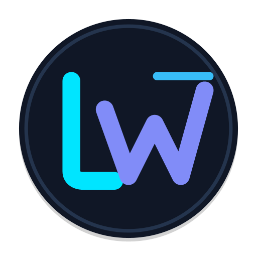

# LW Launcher (Lightweight Pixel-Style Launcher)

<p align="center">
  
</p>

<p align="center">
  <b>An ultra-lightweight (~399 KB APK), pure-Java Android 11–17 home launcher featuring Pixel-style adaptive icon launch morphing, SurfaceFlinger frosted blur, full-color Google Search capsule, and auto-adaptive high refresh rate pacing (60–180 Hz).</b>
</p>

<p align="center">
  
  
  
  
  
</p>

---

## Highlights in v4.0.0

- 🚀 **Continuous Pixel-Style App Launch Morph (`LaunchTransitionView`)**:
  - Morphs seamlessly from exact circular icon bounds into a Material You rounded splash card with separated adaptive foreground/background layers (`AdaptiveIconDrawable`), subtle vertical parallax, ambient 3D shadow, and continuous handoff into the opening app window.
  - Pre-warms Dock and Home Page 0 layers off the main thread for fast cold and warm opens.
- ⚡ **Auto-Adaptive Maximum Display Refresh Rate (`DisplayRefreshHelper`)**:
  - Automatically adapts physics, fling friction, overshoot tension, and `Surface.setFrameRate` / `WindowManager` preferred display mode up to your panel's maximum supported refresh rate (60 / 90 / 120 / up to 180 Hz) on touch and motion with zero manual configuration clutter.
- 🔍 **Pixel App Drawer & Original Google Capsule**:
  - Interactive mid-air App Drawer (`AppDrawerController`) with SurfaceFlinger window background blur, dynamic A–Z fast scrollbar (`DrawerFastScrollbarView`), app predictions row, and inline app + live web suggestions + Play Store fallback search.
  - Full-color original **Google G** (Google App), **4-color Mic** (Google Voice Search), and **4-color Lens** (Google Lens) logos in the drawer search capsule.
- 🎯 **Swipe-vs-Tap Isolation & Smooth Paging (`SmoothHomePager`)**:
  - Deterministic `12dp` touch-move slop (`isGestureTapEligible()`) and diagonal swipe interception (`dx > dy * 0.85f`) ensure page swipes, drawer drags, and diagonal flicks over icons never trigger accidental app launches.
- 🌦️ **Standalone At a Glance & Live Weather (`LiveWeatherController`)**:
  - Works on all Android 11–17 devices (Pixel and non-Pixel alike) without requiring stock Pixel Launcher — powered by Open-Meteo (`INTERNET`, `ACCESS_NETWORK_STATE`, `ACCESS_WIFI_STATE`, `ACCESS_COARSE_LOCATION`), live `ConnectivityManager.NetworkCallback` auto-sync, and direct Background Data Restriction guidance when network access is blocked.
- 🗑️ **Lawnchair-Style DragLayer, Uninstall & Folder Merging**:
  - Real-time floating drag card with top **Remove** and **Uninstall** drop targets (`ACTION_DELETE` / `REQUEST_DELETE_PACKAGES`), multi-page drag chips, long-press app/shortcut menus (`animatePopIn`), smart folder merging, and automatic single-item folder dissolve.
- 🎨 **Material You Day/Night Dynamic Theme (`LauncherTheme`)**:
  - Adapts search bars, drawer sheets, popups, customization panel, and system bar icons dynamically across Android Light & Dark themes and Material You system accent tokens.

---

## Project Structure

```
├── app/
│   ├── AndroidManifest.xml                  # Permissions, HOME intent-filters, version 4.0.0
│   ├── res/
│   │   ├── anim/                            # Custom launch fade/hold window handoff animations
│   │   ├── drawable/                        # Google G/Mic/Lens vectors, weather icons, squircle surfaces
│   │   ├── layout/                          # Home, drawer, menus, folders, settings & widget picker
│   │   ├── values/ & values-night/          # Light & dark adaptive Material You color/theme tokens
│   └── src/com/custom/pixellauncher/
│       ├── MainActivity.java                # Core workspace, drag engine, gestures, widgets & launch host
│       ├── LaunchTransitionView.java        # 120+ FPS Pixel icon-to-window morph overlay
│       ├── DisplayRefreshHelper.java        # Auto-adaptive 60–180 Hz refresh mode & frame pacer
│       ├── UiMotion.java                    # Shared synchronized layer motion & SurfaceFlinger blur
│       ├── SmoothHomePager.java             # High-FPS horizontal workspace pager
│       ├── AppDrawerController.java         # Interactive mid-air drawer gesture controller
│       ├── DrawerFastScrollbarView.java     # A–Z fast index scrubber
│       ├── IconNormalizer.java              # Pixel circle normalization & adaptive layer extraction
│       ├── LiveWeatherController.java       # Standalone Open-Meteo weather + network callback sync
│       ├── LauncherTheme.java               # Day/Night Material You palette manager
│       ├── HomeItemAdapter.java             # Workspace grid adapter
│       ├── AppAdapter.java                  # Drawer & search ranking adapter
│       ├── AppInfo.java                     # App metadata & splash tint model
│       ├── FolderInfo.java                  # Smart folder icon composer & persistence
│       └── LauncherItem.java                # Grid/folder item wrapper
├── tools/                                   # Standalone SDK build tools (AAPT2, D8, bundletool)
├── build_release.py                         # Zero-Gradle signed .AAB and universal .APK pipeline
└── LICENSE                                  # Apache License 2.0
```

---

## Building from Source

No Gradle or Android Studio is required. Build both the signed Play-ready `.aab` and universal `.apk` using pure Java 17 + `build_release.py`:

```cmd
python build_release.py
```

Outputs are generated in `release/`:
- `release\LW_Launcher_v4.0.0.apk` (~399 KB)
- `release\LW_Launcher_v4.0.0.aab` (~228 KB)

---

## License

This project is licensed under the **Apache License 2.0** — see [LICENSE](LICENSE) for details.
